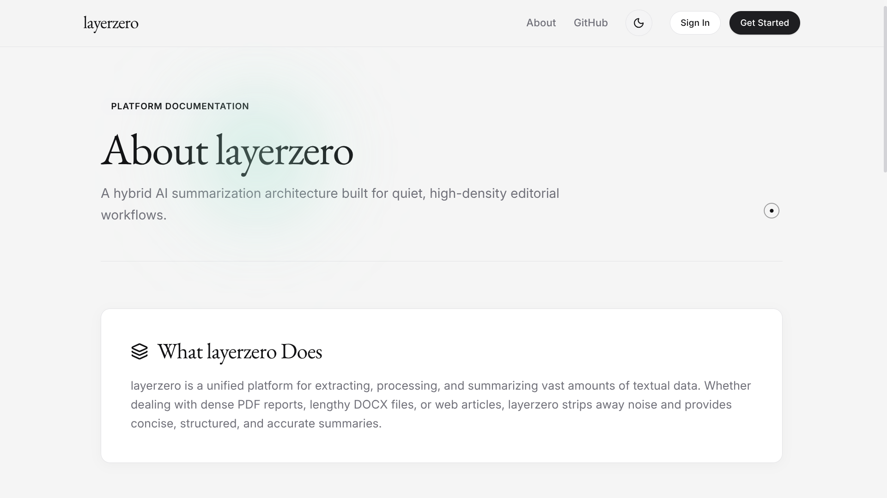
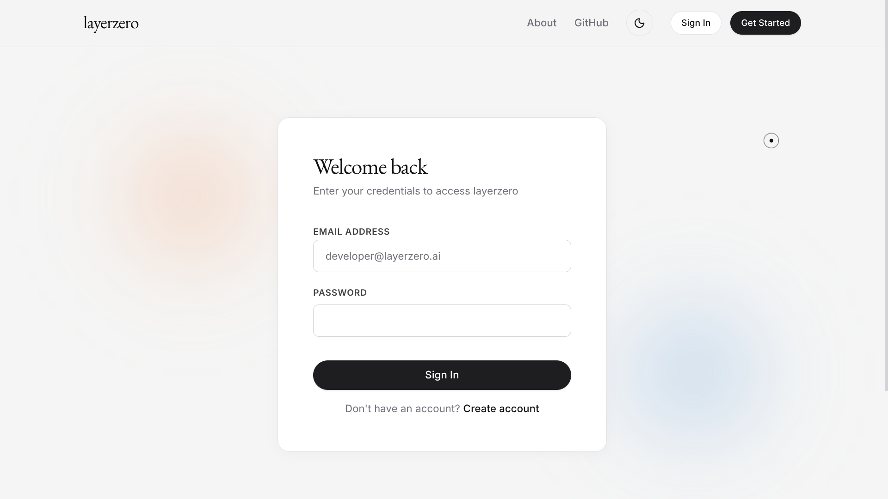
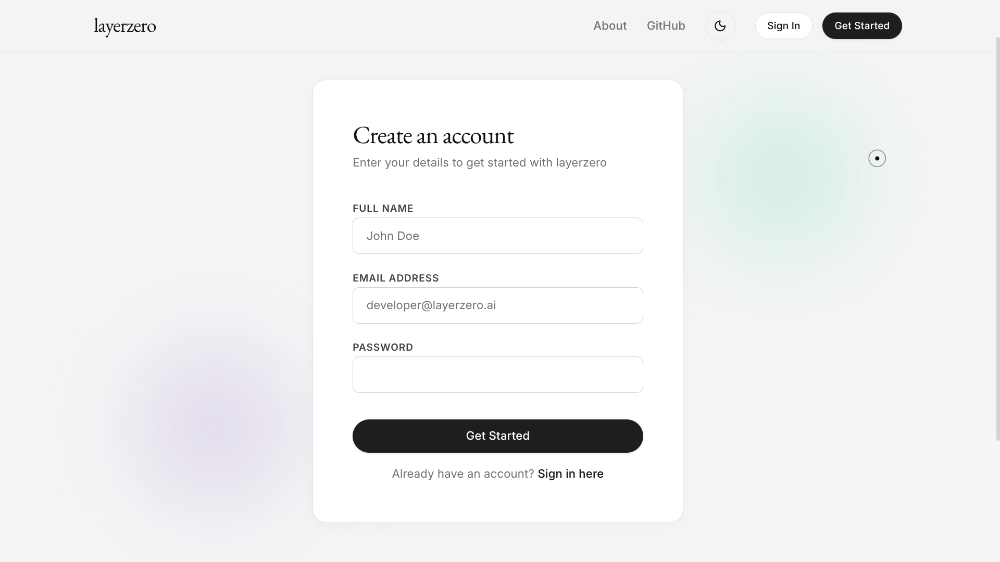
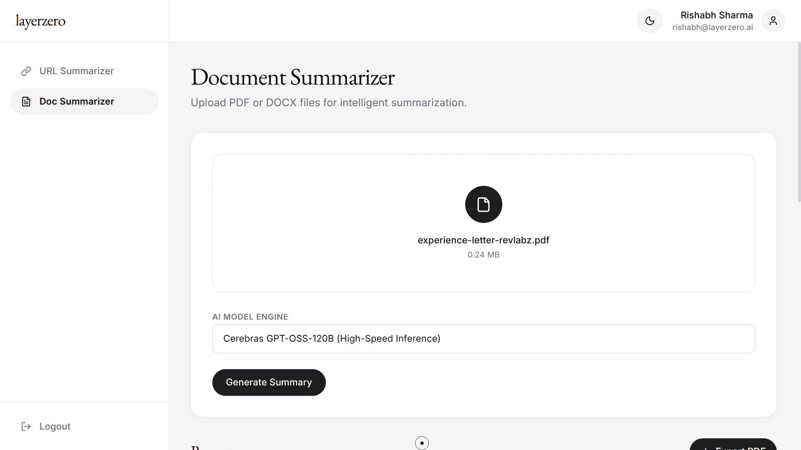
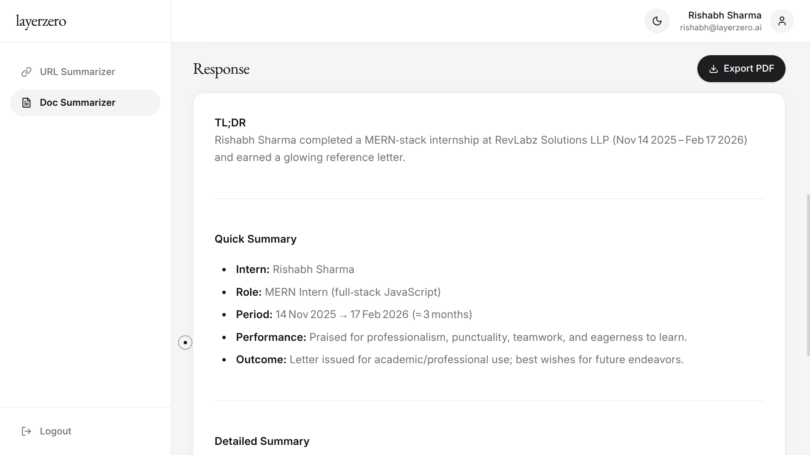

# Layerzero

Layerzero is a full-stack web application for summarizing web articles, PDF files, and DOCX documents using multiple AI models. It extracts text in memory, deduplicates requests using SHA-256 hashes, caches summaries in Redis, and stores user history in MongoDB.

---

<table align="center">
  <tr>
    <td align="center">
      <strong>Homepage</strong><br>
      
    </td>
    <td align="center">
      <strong>About</strong><br>
      
    </td>
  </tr>
  <tr>
    <td align="center">
      <strong>Login</strong><br>
      
    </td>
    <td align="center">
      <strong>Register</strong><br>
      
    </td>
  </tr>
  <tr>
    <td align="center">
      <strong>Doc Summarizer</strong><br>
      
    </td>
    <td align="center">
      <strong>Response</strong><br>
      
    </td>
  </tr>
</table>

---

## Supported Models

Users can choose between four model backends per request:

| Key | Model | Provider | Description |
|---|---|---|---|
| `gemini` | Gemini 3.5 Flash Lite | Google | Cloud model for general summarization |
| `groq` | GPT-OSS-20B | Groq | Fast open-weights inference |
| `sarvam` | Sarvam 30B | Sarvam AI | Specialized for Hindi and Hinglish text |
| `gemma` | Gemma 4 | Ollama (Local) | Runs locally on the host machine via Ollama |

---

## How It Works

1. **Input Submission:** The user submits a web link or uploads a file (PDF or DOCX, up to 5MB).
2. **Text Extraction:**
   - **Web Links:** Fetched with Axios, parsed into a DOM via JSDOM, and cleaned with Mozilla Readability to remove navigation bars, ads, and footers.
   - **PDFs:** Parsed from memory buffers using `pdfjs-dist`.
   - **DOCX:** Extracted from memory buffers using `mammoth`.
3. **Hashing & Cache Lookup:**
   - Extracted text is hashed with SHA-256 (`crypto.createHash('sha256')`).
   - The backend checks MongoDB for an existing summary by this user, then checks Upstash Redis for a cached response under `${client}:${hash}` (or `${client}:${url}`).
   - If a cached summary exists, it returns immediately without calling the AI provider.
4. **AI Generation:**
   - On a cache miss, the text is routed to the selected model client.
   - Prompts instruct the model to return a JSON object with `title` and `summary`.
   - Before parsing, any markdown code fences (````json ... ````) are stripped with a regular expression to prevent syntax errors.
5. **Storage:**
   - The summary is cached in Redis with a 24-hour TTL.
   - The summary is saved to MongoDB under the user's ID along with the source type, content hash, and timestamp.
6. **Export:**
   - Summaries can be viewed in the dashboard history, copied to clipboard, or exported to PDF in the browser using `jsPDF`.

---

## Architecture

```text
User Request (URL or Document)
       │
       ▼
Express API (Rate limited via Upstash Redis)
       │
       ▼
JWT Cookie Authentication (protectRoute)
       │
       ▼
Text Extraction (Readability / pdfjs-dist / mammoth)
       │
       ▼
SHA-256 Hash of Content
       │
       ├──────────────► Cache Hit (Redis or MongoDB) ──► Return Saved Summary
       │
       ▼ (Cache Miss)
Selected AI Client (Gemini / Groq / Sarvam / Ollama)
       │
       ▼
Strip Markdown Fences & JSON.parse()
       │
       ├──────────────► Cache in Redis (24h TTL)
       ├──────────────► Save to MongoDB (User History)
       │
       ▼
Return JSON { output, title, cached }
```

---

## Tech Stack

### Frontend
- **Framework:** React 19, Vite
- **Language:** TypeScript
- **Styling:** Tailwind CSS v4
- **Markdown & PDF:** `marked`, `jsPDF`, `html2canvas`
- **HTTP Client:** Axios

### Backend
- **Runtime:** Bun / Node.js
- **Framework:** Express 5
- **Database:** MongoDB with Mongoose
- **Cache & Rate Limiting:** Upstash Redis (`@upstash/redis`, `@upstash/ratelimit`)
- **Logging:** Pino with `pino-pretty` (dev only)
- **Auth:** JWT (`httpOnly` cookies), bcrypt, Nodemailer (email verification)
- **File Parsing:** `multer`, `pdfjs-dist`, `mammoth`, `jsdom`, `@mozilla/readability`

---

## API Endpoints

### Authentication (`/api/auth/user`)

| Method | Endpoint | Auth | Rate Limit | Description |
|---|---|---|---|---|
| `POST` | `/api/auth/user/register` | Public | 20 req / 10m | Register new user and send verification email |
| `GET` | `/api/auth/user/verify/:token`| Public | 20 req / 10m | Verify email token and redirect to login |
| `POST` | `/api/auth/user/resend` | Public | 3 req / 24h | Resend email verification link |
| `POST` | `/api/auth/user/login` | Public | 20 req / 10m | Authenticate and set `httpOnly` JWT cookie |
| `POST` | `/api/auth/user/logout` | Public | None | Clear JWT cookie |
| `GET` | `/api/auth/user/check` | Cookie | 20 req / 10m | Get current user profile |
| `PUT` | `/api/auth/user/update` | Cookie | 20 req / 10m | Update profile name, email, or password |
| `DELETE`| `/api/auth/user/delete` | Cookie | 20 req / 10m | Delete account and data |

### Summarization (`/api/scrape`)

| Method | Endpoint | Auth | Rate Limit | Description |
|---|---|---|---|---|
| `POST` | `/api/scrape/web` | Cookie | 30 req / 15m | Scrape URL, check cache, summarize text |
| `POST` | `/api/scrape/doc` | Cookie | 30 req / 15m | Parse uploaded PDF/DOCX file, check cache, summarize text |

### History (`/api/summaries`)

| Method | Endpoint | Auth | Rate Limit | Description |
|---|---|---|---|---|
| `GET` | `/api/summaries` | Cookie | 50 req / 60m | List all summaries saved by the authenticated user |

---

## Environment Variables

Copy `server/.env.example` to `server/.env` and update the values:

```env
PORT=5000
HTTPS_PORT=5001
NODE_ENV=development
LOG_LEVEL=debug
CLIENT_URL=http://localhost:5173
API_URL=http://localhost:5000

MONGODB_URI=mongodb://localhost:27017/layerzero
UPSTASH_REDIS_REST_URL=https://your-upstash-redis.upstash.io
UPSTASH_REDIS_REST_TOKEN=your_token

JWT_SECRET=your_jwt_secret
EMAIL_USER=your_email@gmail.com
EMAIL_APP_PASSWORD=your_gmail_app_password

GEMINI_API_KEY=your_gemini_key
GEMINI_MODEL_NAME=gemini-3.5-flash-lite

GROQ_API_KEY=your_groq_key
GROQ_MODEL_NAME=openai/gpt-oss-20b

SARVAM_API_KEY=your_sarvam_key

OLLAMA_MODEL=gemma:4b
OLLAMA_BASE_URL=http://localhost:11434
```

---

## Local Setup

### Using Docker

```bash
./start.sh
# or
docker compose up --build -d
```

### Manual Setup

1. **Backend:**
   ```bash
   cd server
   bun install   # or: npm install
   cp .env.example .env
   bun dev       # or: npm run dev
   ```

2. **Frontend:**
   ```bash
   cd client
   npm install
   npm run dev
   ```

3. **Run Tests:**
   ```bash
   cd server
   bun test
   ```

---

## License

MIT
